# appleboblin's zmk-config

My personal [ZMK firmware](https://github.com/zmkfirmware/zmk/)
configuration. It currently covers choc spaced Corne from [Typeractive](https://typeractive.xyz/).

## Keymap



_Auto-generated by [keymap-drawer](https://github.com/caksoylar/keymap-drawer) on every keymap change._

## Display

Both halves use a [nice!view](https://nicekeyboards.com/nice-view) with
[nice-view-custom](https://github.com/appleboblin/nice-view-custom):
battery and connection status on top, art in the middle, profile and
layer at the bottom.

The art is `config/jigglypuff.c`, generated from `config/jigglypuff.png`
and enabled in `config/corne.conf`:

```
CONFIG_NICE_VIEW_CUSTOM_ART="jigglypuff.c"
```

To change it, draw a 1-bit image (max 68×112, upright) and convert it
inside the dev shell:

```bash
png2lvgl config/jigglypuff.png -o config/jigglypuff.c --invert
```

`--invert` is needed because the PNG is white on black.

## Setup

The local build process is a modified version of urob's, using `nix` and `just`. The flake
provides the development environment required to compile ZMK firmware.

### Prerequisites

(Read urob's [build environment docs](https://github.com/urob/zmk-config/blob/main/docs/build-env.md) for more information.)

- Nix package manager with flake support
- Optional: [direnv](https://direnv.net/) to enter the environment automatically

### Set up workspace

1. Clone the repository you forked.

```bash
# Replace `appleboblin` with your username
git clone https://github.com/appleboblin/zmk-config
cd zmk-config
```

2. Enter the development environment and initialize the workspace.

```bash
# Enter the dev shell (or run `direnv allow` once if you use direnv)
nix develop

# Initialize the Zephyr environment, download ZMK dependencies,
# and add them to .gitignore
just init
```

Run `nix develop` again in each new terminal before using `just`.

## Usage

Your zmk-config folder should look something like this after following the steps above:

```
zmk-config
├── config
├── firmware (after building)
├── keymap-drawer (generated diagram)
├── modules (Zephyr HALs)
├── nice-view-custom
├── zephyr
├── zmk
├── zmk-auto-layer
└── zmk-helpers
```

### Building the firmware

To build the firmware, type `just build` from anywhere in the folder. It defaults to building all board and shield combinations listed in `build.yaml`.

Use `just build <target>` to build the firmware that matches the target. `just list` shows all valid build targets. For example, `just build corne` builds both `corne_left` and `corne_right`. Generated firmware will be in the `firmware` folder.

To clear the build cache, type `just clean`. To clear the generated environment, type `just clean-all`.

#### Updating the build environment

`just update` pulls the latest ZMK and modules from `config/west.yml` (all on `main`).
Commit any local changes to ZMK or modules first; this overwrites them.

`just upgrade-sdk` updates all Nix inputs (`flake.lock`). Use with care: it can break
the build environment. Commit `flake.lock` once a build succeeds.

(Adapted from [urob's build-env docs](https://github.com/urob/zmk-config/blob/main/docs/build-env.md).)

## Inspiration

My configuration is heavily inspired by, and uses code from, [urob](https://github.com/urob/zmk-config).
